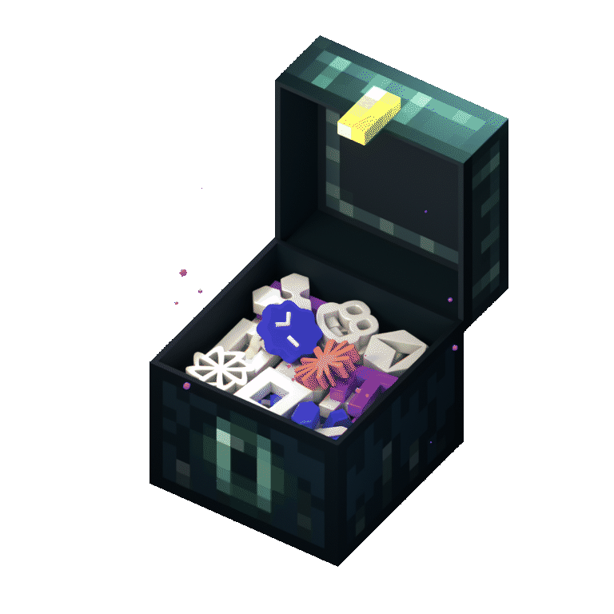
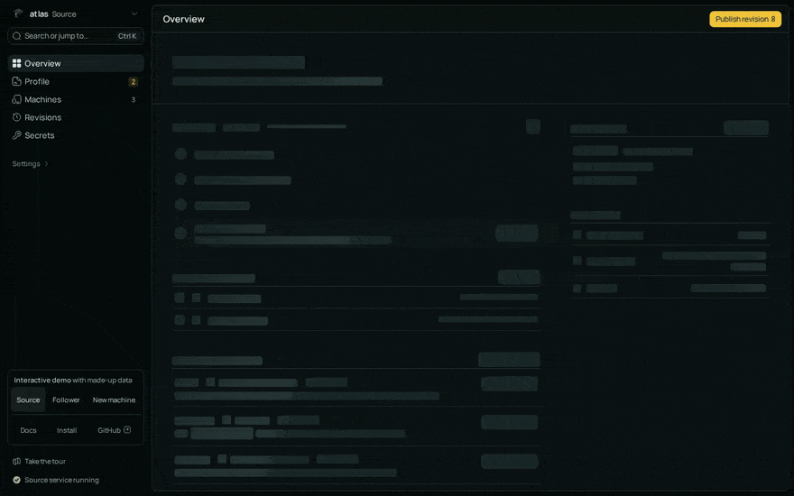
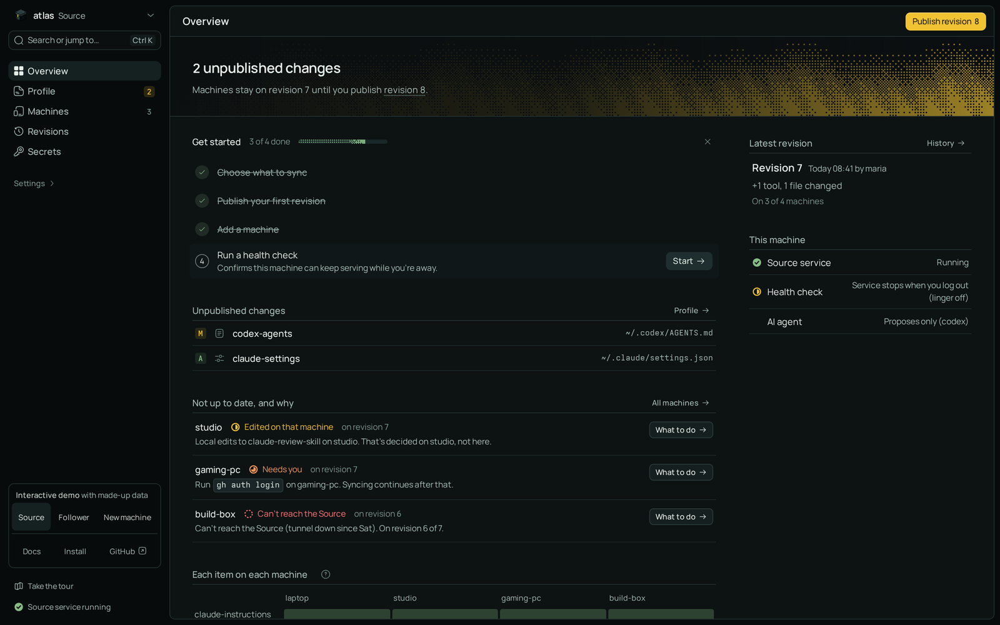
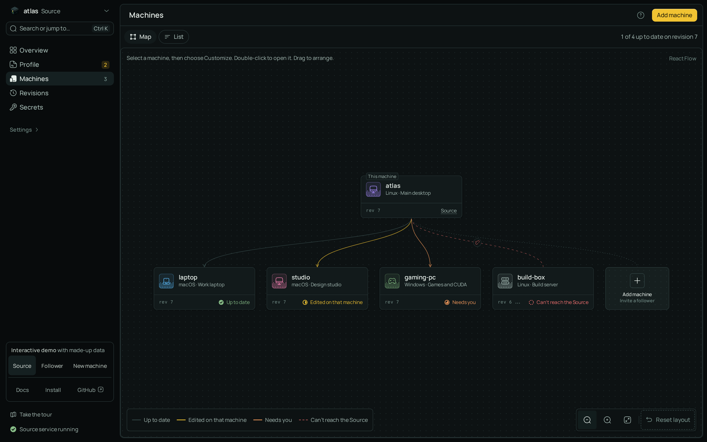
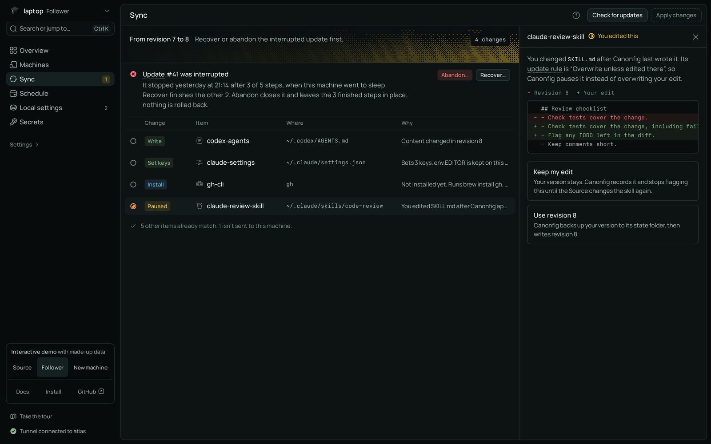
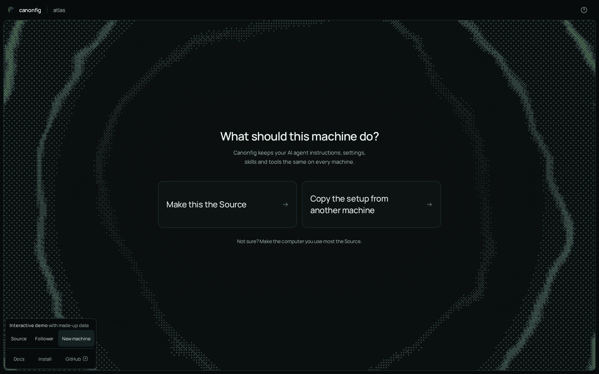

<div align="center">

  

  <h1>canonfig</h1>
  <p>one-way sync for ai agent configuration.</p>

  <p>
    <a href="https://www.npmjs.com/package/@microck/canonfig"><picture><source media="(prefers-color-scheme: dark)" srcset="https://shieldcn.dev/npm/@microck/canonfig.svg?variant=secondary&amp;size=xs&amp;logo=false&amp;mode=dark"></picture></a>
    <a href="https://www.npmjs.com/package/@microck/canonfig"><picture><source media="(prefers-color-scheme: dark)" srcset="https://shieldcn.dev/npm/dt/@microck/canonfig.svg?variant=secondary&amp;size=xs&amp;logo=false&amp;mode=dark"></picture></a>
    <a href="https://github.com/Microck/canonfig/actions/workflows/acceptance.yml"><picture><source media="(prefers-color-scheme: dark)" srcset="https://shieldcn.dev/github/ci/Microck/canonfig.svg?workflow=acceptance.yml&amp;branch=main&amp;variant=secondary&amp;size=xs&amp;logo=false&amp;mode=dark"></picture></a>
    <a href="LICENSE"><picture><source media="(prefers-color-scheme: dark)" srcset="https://shieldcn.dev/github/license/Microck/canonfig.svg?variant=secondary&amp;size=xs&amp;logo=false&amp;mode=dark"></picture></a>
  </p>
</div>


---

`canonfig` keeps your global ai agent setup consistent across linux, macos, and
windows. you author it once in `~/.canonfig/` on the Source Machine: shared
instructions, rules, skills, agents, commands, hooks, MCP servers, settings and
tool recipes. canonfig projects that folder into every installed harness's own
global files, publishes it as immutable, signed Profile Revisions, and
Follower Machines mirror and project what they are authorized to receive.
followers never publish changes back.

deterministic actions run first. optional Configuration Agents handle bounded
fallback tasks; an agent's claim never counts as proof of convergence.

[documentation](https://canonfig.micr.dev/docs) | [interactive demo](https://canonfig.micr.dev) | [first sync](https://canonfig.micr.dev/docs/tutorials/first-sync/) | [CLI reference](https://canonfig.micr.dev/docs/reference/cli/)

## why

every agent harness keeps its own instructions, skills and MCP config in its
own format. keeping them in sync across harnesses and machines usually means
copying files by hand. canonfig gives you one folder for all of it, writes each
harness's native files for you, backs up what it replaces, and keeps
machine-local items in `~/.canonfig/local/`. native schedules keep followers up
to date without a resident follower daemon.

## install

requires Node.js 24+ and npm. install the same release on the source and every follower:

```sh
npm install --global @microck/canonfig@7.1.7
canonfig --version
canonfig doctor --no-input
```

check the `credentials` result before continuing. canonfig uses Secret Service
on linux, Keychain on macos, and Credential Manager on windows.

## browser interface



run the browser interface on this machine:

```sh
canonfig ui
```

it opens this machine's workspace, or setup when the machine is not configured.
the server runs in your terminal on `127.0.0.1` with a free port. use
`canonfig ui --port 5317 --no-open` to choose a port and open the printed
single-use URL yourself. stop it with Ctrl-C.

on a Source, author the profile, choose harnesses and groups, validate and publish
revisions, manage secrets, export the profile, and invite followers. on a Follower,
inspect and apply sync plans, recover or abandon interrupted runs, edit allowed
local items and overlays, manage harness exclusions, restore backups, refresh
secrets, and set the schedule. both roles show real status and settings.
errors keep the CLI's diagnostics. map names and appearance stay in this browser.
the Source card on a Follower shows "Source" and its endpoint because enrollment
does not store the Source machine's name.

self-update status, checks, enable, disable and apply are available on the
Version page in Settings. stop other Canonfig processes before updating; after
activation, restart with `canonfig ui`. unenrollment leaves applied files,
the native schedule and tunnel configuration in place, as the CLI does.

the [interactive demo](https://canonfig.micr.dev) and images below use made-up
machines. its fleet health, revision and progress displays are not remote
telemetry from the live GUI.

<table>
  <tr>
    <td width="50%"><br><b>overview</b>: what you haven't published yet, and which machines are behind and why</td>
    <td width="50%"><br><b>machines</b>: every follower, its revision and its sync state</td>
  </tr>
  <tr>
    <td width="50%"><br><b>sync</b>: the planned changes on a follower, per harness</td>
    <td width="50%"><br><b>setup</b>: a new machine becomes the Source or copies its setup from one</td>
  </tr>
</table>

## sync machines

start with the [first sync tutorial](https://canonfig.micr.dev/docs/tutorials/first-sync/).
it covers setup, the folder, the source service, the pinned connection, and
follower enrollment.

on the source, setup detects your harnesses, offers to import what they
already hold, and scaffolds `~/.canonfig/`:

```sh
canonfig setup plan --role source
canonfig setup approve --approver "$USER"
canonfig setup apply
```

edit the folder, then project it into this machine's harnesses:

```sh
canonfig sync --plan
canonfig sync --apply
```

setup writes a `profile` named after the machine's hostname into
`~/.canonfig/canonfig.jsonc`; rename it there if you want, then publish:

```sh
canonfig source publish --reviewer "$USER"
```

after enrollment, run on the follower:

```sh
canonfig sync --plan
canonfig sync --apply
canonfig status
```

`Converged` means declared resources match, not that an agent client has
loaded them. see [publish from the folder](https://canonfig.micr.dev/docs/how-to/publish-from-the-folder/)
and the [folder reference](https://canonfig.micr.dev/docs/reference/canonfig-folder/).

### harnesses

canonfig projects into codex, claude-code, amp, oh-my-pi, pi, factory-droid,
cursor, devin, opencode, grok-build, antigravity, copilot-cli, kimi, kilo,
hermes and qwen. a machine projects the harnesses listed in `canonfig.jsonc`
that are installed and not excluded locally:

```sh
canonfig harnesses
canonfig harnesses exclude cursor
```

see [choose harnesses](https://canonfig.micr.dev/docs/how-to/choose-harnesses/)
and the [harness reference](https://canonfig.micr.dev/docs/reference/harnesses/).

### backups and restore

before its first write to a harness, and before `import --replace` replaces
folder entries, canonfig snapshots what it replaces under
`~/.canonfig/.backups/`. it keeps the first harness snapshot, the first folder
snapshot and the four most recent.

```sh
canonfig restore
```

see [restore from a backup](https://canonfig.micr.dev/docs/how-to/restore-from-a-backup/).

### export and import

export writes the folder (plus `local/`) to one private `.tar.gz` with a
`manifest.json` of every file's size, sha-256 and mode, signed with the source
key when you export on the source. state, backups and credentials never go in.
import checks the signature and every checksum and writes the folder back as a
journaled run on a machine that isn't an enrolled follower. `--expect-key`
refuses anything your source didn't sign.

```sh
canonfig export --output ~/canonfig-setup.tar.gz
canonfig import ~/canonfig-setup.tar.gz --dry-run
canonfig import ~/canonfig-setup.tar.gz
```

see [export and import](https://canonfig.micr.dev/docs/how-to/export-and-import/).

### machine-local items

put rules, skills, agents and commands for one machine in `~/.canonfig/local/`,
and MCP servers and settings in `~/.canonfig/local/local.jsonc`. they are never
published and never replaced. see
[add machine-local items](https://canonfig.micr.dev/docs/how-to/add-machine-local-items/).

### schedule updates

```sh
canonfig schedule set daily@09:00
canonfig schedule status
```

schedules follow the user's login session by default. see
[schedules](https://canonfig.micr.dev/docs/how-to/manage-schedules/) and
[unattended operation](https://canonfig.micr.dev/docs/how-to/run-unattended/)
for boot or logged-out operation.

## update upstream skills

register an existing skill's Git source with `canonfig skills track`, then
preview updates before applying them:

```sh
canonfig skills check
canonfig skills update --apply
```

local edits block an update rather than being discarded. see
[tracking, local edits and recovery](docs/skill-updates.md).

## self-updates

opt-in `canonfig self-update` installs stable releases for user-owned global npm
installs. manual updates stay in the current major; automatic updates take
current-line patches or newer majors, never an in-major minor. read
[setup, automation and recovery](docs/self-update.md) before enabling it.

## what gets applied

| folder item | default behavior |
| --- | --- |
| instructions, rules, agents, commands | written into each harness's native files and directories |
| skills | replaced only if the installed copy is unmodified |
| MCP servers, hooks, settings | merged as owned keys; harness-owned keys and credentials are preserved |
| tools | run a platform recipe and independently verify it |
| credentials | require a local credential reference; never copy it as profile content |

read the [folder reference](https://canonfig.micr.dev/docs/reference/canonfig-folder/)
for every key and file.

## trust and boundaries

- enrollment pins source TLS and signing identities; changed pins, invalid
  signatures and replayed invitations fail closed
- each follower has an independently revocable identity and group assignment
- profile credentials stay local; named secrets are shared only with followers
  enrolled in `canonfig:secrets`
- Configuration Agents are bounded by allowlists; elevation, login, restart and
  reboot are denied

see [security and credentials](https://canonfig.micr.dev/docs/reference/security/).

## agent skills

let an AI agent install, set up or operate canonfig for you with the
[install](skills/install-canonfig/SKILL.md), [setup](skills/setup-canonfig/SKILL.md)
and [operate](skills/operate-canonfig/SKILL.md) skills.

## development

```sh
npm ci
npm ci --prefix ui
npm run build:cli
npm run docs:validate
npm test
```

the browser frontend lives in [`ui/`](ui/README.md). its development server runs
the simulated demo (`npm --prefix ui ci`, then `npm run ui:dev`). see the
[release runbook](docs/release-runbook.md) for every release gate.

## license

[MIT](LICENSE)
