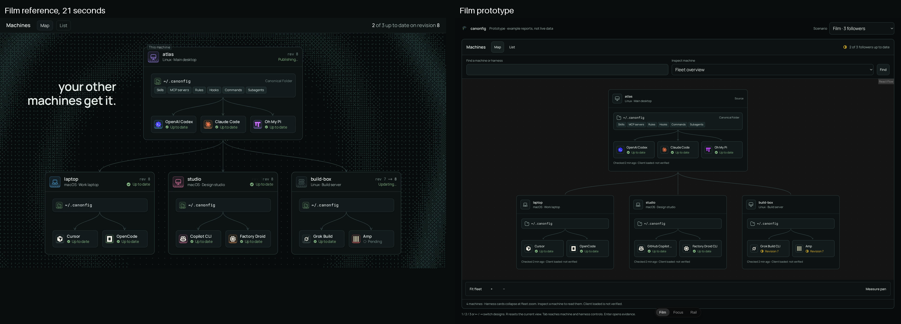
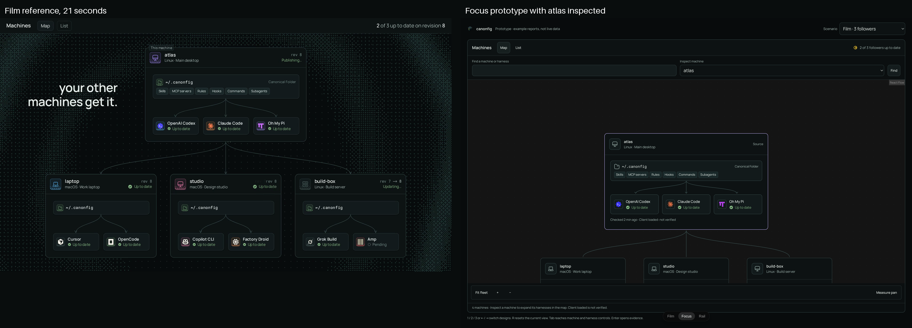
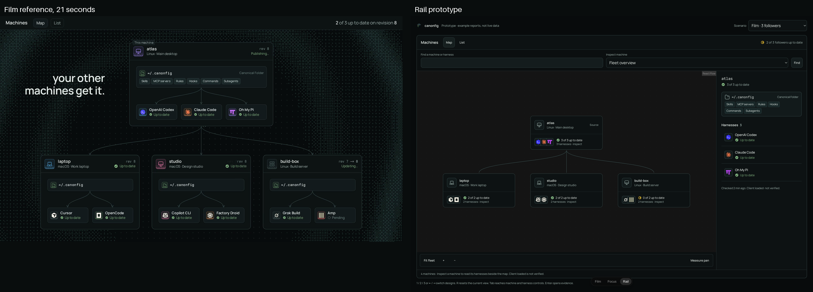

# Harnesses on the machine map

Issue [#290](https://github.com/Microck/canonfig/issues/290). Prototype phases 1-6 only. **No design has been selected.** The picker decides; production integration follows that choice.

## Findings

The film shows a machine enclosing its Canonical Folder and a row of harness cards. Each harness has a logo, name and state. Internal folder-to-harness lines express projection; external Source-to-Follower lines express synchronization. These are different relationships and must remain visually distinct.

The product currently has one React Flow node per machine. Keep that unit: harnesses need semantic controls, not independent drag positions or React Flow edges. Use one memoized machine component with nested HTML. This avoids multiplying the graph by the harness count and makes each harness a native keyboard target.

The prototype uses the product's Manrope and Ioskeley Mono fonts, Ender tokens, Button and StatusMark components, Solar icons, and React Flow. Its data is explicitly synthetic. Round 2 adds marked, DEV-only call-site mounts; the production MachineMap implementation still imports no prototype code and remains unchanged.

## Directions

| Variant | Axis | When it wins | Cost |
| --- | --- | --- | --- |
| Film | Folder and harness cards visible inside every machine | Small fleets; closest to the supplied film | More space per machine; requires disclosure at fleet zoom |
| Focus | Compact summaries; selected machine expands in place | Inspect a few machines while preserving their topology | Selection changes layout and hides other harness details |
| Rail | Compact topology plus an unscaled harness inspector | Large fleets and long names; stable reading size | Splits attention between the graph and inspector |

All three retain search, Map/List, a focus action, explicit evidence, and empty/error states. At distant fleet zoom they show a larger machine label and status mark instead of mounting tiny logos and metadata. Film opens its folder and harness cards for small fleets, collapses them at fleet zoom, and expands an inspected machine in larger fleets. Focus expands only the selected machine. Rail keeps details outside the scaled graph. At narrow widths, an inspected machine also has an unscaled inventory below the map. Lists are paginated rather than rendering 320 expanded machine inventories.

Recommended invariant, not a chosen variant: show details at a legible size, keep one graph node per machine, and never imply verification from enrollment or detection. The user's choice between the three disclosure models remains open.

### Round 2 contract

The user wants to judge Film and Focus against the real app shell, sidebar, header and neighboring sections. The isolated page only imitates that context. Development-only mounts now compare Current, Film and Focus at `/source/machines` and `/follower/machines`; Rail remains on `/proto/map-harnesses` only. Current uses the unchanged real map and existing demo records. Stress scenarios and appearance controls affect the prototype variants, not Current.

Source Overview has no MachineMap call site in this checkout. Its Current variant preserves the existing page. Film and Focus add a temporary comparison section below the status header at `/source/overview`, above the existing columns. This is explicitly new prototype placement, not a claim about the current product.

Variants remain in `ui/src/proto/map-harnesses/`. Fences named `proto:map-harnesses start` and `proto:map-harnesses end` identify every temporary declaration and mount in `ui/src/workspace/machines.tsx` and `ui/src/workspace/source.tsx`. The import gate is `import.meta.env.DEV`, not a shippable feature flag. The prototype also rejects a provider without `simulatedTelemetry`. No live endpoint is used.

The neutral, fixed control panel compares original film colours, monochrome glyphs, dithered glyphs and brand-coloured tiles, combined with no card colour, brand tint or a dithered gradient. A 0-50% tint slider writes CSS variables directly instead of rerendering the graph. Settings persist in the URL and can be copied. Brand treatments are design experiments, not approved trademark usage. See [brand-research.md](brand-research.md) for official assets, restrictions and status-colour collisions.

| Key | Variant | Axis | When it wins | Cost |
| --- | --- | --- | --- | --- |
| 1 | Current | Unchanged production map | Compare against the real baseline and its existing controls | No per-harness view; Overview has no map |
| 2 | Film | Nested folder and harness cards | Inspect a small fleet with the film's visual hierarchy | Large cards need zoom or disclosure |
| 3 | Focus | Expand the inspected machine | Read one inventory while retaining compact neighbors | Other harness details stay collapsed; selection changes layout |

Open `/source/machines?v=1`, `/source/overview?v=1` or `/follower/machines?v=1` on the existing server. Number keys and Left/Right switch; R resets. Open **Map prototype controls** for scenario, logo, card colour, tint and Copy config. Current ignores these appearance and scenario controls. On `/proto/map-harnesses`, keys 1/2/3 still mean Film/Focus/Rail.

Round-2 agent checks:

- All three in-place variants rendered on both Machines screens and Source Overview. The isolated Film/Focus/Rail picker also passed number and arrow switching.
- All 72 Film/Focus combinations of four logo styles, three card styles and tint strengths 0%, 18% and 50% passed computed text contrast checks. Lowest name contrast: 14.91:1. Lowest state-text contrast: 7.86:1. This is not a claim that every stylized logo satisfies a brand policy.
- Native controls changed styles and URL state. Home/End set the tint endpoints without switching variants. Copy config reported Copied and selected the complete config.
- Native Tab reached a harness; Enter opened its evidence dialog; Escape restored focus to that harness. Client loaded stayed Not verified.
- Fresh-tab captures of Source, Follower, Overview and the isolated picker had no console warnings or errors. The contrast probe's separate tab emitted Canvas2D readback diagnostics; those were probe-generated, not suppressed application errors.
- UI typecheck passed. Scoped lint passed with four warnings in unchanged workspace code: two fast-refresh export warnings, one ref-during-render warning, and one effect state-update warning. The prototype has no lint diagnostics.
- Browser inspection caught Overview's flex basis overriding its 620px height, and Gemini's opaque colour icon producing a solid mask. The map now measures 620px; Gemini's supplied transparent monochrome SVG keeps its glyph visible in every treatment.
- The simplification reuse, quality and efficiency passes ran inline under the no-subagent constraint. Reuse and quality needed no further changes. The efficiency pass reduced the new Gemini PNG from 2048px to 128px, 6,249 bytes. No independent review claimed.

Evidence: [browser checks](round-2-browser-checks.json), [Current](round-2-source-current.png), [Film](round-2-source-film.png), [Focus](round-2-source-focus.png), [Overview Current](round-2-overview-current.png), [Overview Film](round-2-overview-film.png), [Overview Focus](round-2-overview-focus.png), [original logos](round-2-treatment-original.png), [monochrome](round-2-treatment-mono.png), [dither](round-2-treatment-dither.png), and [brand tiles](round-2-treatment-tile.png). These repository copies are resized to 1600 x 1100; browser originals are 3200 x 2200.

Pan timings below are the round-1 measurements, not a new round-2 performance claim. No winner, promotion or PR yet.

## Prior art

See [sources.md](sources.md) for URLs and source limits.

- React Flow sub-flows support independently positioned child nodes, but parentage is geometric rather than nested DOM. Rejected for harnesses: no user requirement to move a harness separately, and each child adds focus, layout and edge-layer work.
- Tailscale uses machine search/filtering and machine-level inspection. Keep a list route to every machine instead of requiring precise clicks on a fit-to-fleet graph.
- Datadog groups services and scopes its map to observed evidence. Keep topology separate from current health and show the observation's age.
- Grafana hides excess nodes behind explicit expandable summaries. Never hide harnesses without a visible count and a way to inspect them.
- Railway's service tiles open detail. Rail tests that split-view model rather than assuming nested cards are always best.
- Fly's documented overview/list/detail workflow supports progressive inspection. Its public docs did not establish a nested canvas; no private dashboard was accessed.

Rejected alternatives: independent React Flow harness nodes, always-expanded 320-machine maps, logo-only states, hover-only disclosure, synthetic green follower health in the real GUI, and treating a successful write as proof that a client loaded configuration.

## What exists now

Ground truth is main commit `7070b8487191ec813e6405ab53d5591e9459a1df`.

1. `src/gui/contract/enrollment.ts` exposes `GuiMachines` containing enrollment identities and invitations. No follower harness inventory, revision receipt, observation timestamp, or per-harness state exists there. `src/gui/routes/enrollment.ts` returns that inventory.
2. `src/gui/contract/synchronization.ts` exposes **local** `GuiHarnessReport`: installed, rootExists, listed, excluded, selected/detected/not-installed/absent. These are selection and detection facts, not convergence evidence. Executable/root paths must not be copied into remote reports.
3. `src/enrollment/source-server.ts` accepts enrollment lifecycle requests and serves authorized revisions, blobs and secrets. It has no follower harness-report upload route.
4. Completion receipts in `src/runtime/layers.ts` separate `published`, `applied`, `independentlyVerified` and `clientLoaded`. Durable receipt/action evidence lives on the machine doing the work. Run-level verification is not a per-harness check.
5. UI demo records can show machine convergence. They do not prove the live Source knows follower state. A production view must initially show **Not reported**, never copy local Source harnesses into every Follower.

## Proposed end-to-end contract for phase 7

This is a proposal, not an implemented endpoint or existing API.

### Follower observation

Add a bounded, authenticated report to the existing enrollment transport, for example `PUT /v1/transport/observations`. Derive Follower identity from the existing credential, never from a body-supplied Follower ID. Reject revoked/pending credentials and unauthorized revisions using the same transport boundary.

One complete snapshot per Follower contains:

- A durable monotonic observation sequence and report ID for idempotent retries and rejection of late older reports. Sequence must belong to the enrollment, survive restarts, and reset only with a new enrollment identity.
- Observation time, build identity, canonical revision digest/sequence, and run ID when a run produced the report. The Source adds `receivedAt`; follower wall clocks do not decide ordering or freshness.
- Inventory observation status. A successful inventory with `harnesses: []` means zero harnesses. No report, failed inventory collection, and an empty inventory are distinct.
- Per known harness ID: detection (`installed`, `not-installed`, `unknown`), selection (`included`, `excluded`), applied revision, independent verification evidence with its matching revision, and any run outcome (`failed`, `drift`, `needs-action`, or none). Keep evidence scoped to that harness's planned outputs, not a copied run-level success.
- `clientLoaded: { status: "not-verified" }` unless a future independent client-loading mechanism proves otherwise. Projection success alone never changes it.
- Bounded, redacted reason codes and display-safe summaries. No credentials, file content, environment variables, absolute home paths or raw command stderr.

### Collection, storage and GUI

1. Produce per-harness facts from the existing detection, projection, apply and read-back verification stages. Do not infer installation from a directory alone or verification from an exit code. Unsupported checks remain not verified.
2. Persist the local observation before transmission. Publish completed, failed and drifted runs and inventory/selection changes. Reporting failure is separate from local synchronization success and remains visible as a reporting diagnostic. Use the existing schedule; do not invent an always-on heartbeat for the map.
3. Source stores the latest accepted observation keyed by authenticated Follower and records receipt time. Reports are complete snapshots so uninstall/removal does not leave ghost harnesses. Bound body size and counts, and test cross-Follower access, duplicate reports, reordered reports, revocation and stale data.
4. Extend the typed GUI contract and route with each Follower's nullable observation plus Source receive time. No parallel legacy shape. The UI combines the observation with the currently authorized Profile Revision; an observation does not grant resource access.
5. Derive display state once, with explicit precedence: no/failed inventory report, excluded, not installed, failure or human action, drift, behind revision, applied but not independently verified, verified current revision. If observation age exceeds the agreed freshness policy, display **Last report** and its time instead of a current green claim. Never silently make old evidence current.
6. Machine totals count only eligible included/installed harnesses with matching revision evidence. Zero eligible harnesses is **No included harnesses**, not "all up to date". Excluded and absent harnesses stay inspectable and outside the denominator. Machine synchronization status and harness status remain separate summaries.

Contract decisions still needed during promotion: freshness based on configured schedule and receipt age; retention after revocation; which existing verifier outputs can be assigned to a harness; behavior when manual files change between scheduled runs. These do not block a synthetic design comparison but do block truthful live health claims.

## Stress cases and evidence

The repository's **M320 means a 320px-wide container with four Followers**, not 320 Followers. The picker includes M40, M320 width, and a separate F320 case with 320 Followers. It also includes zero Followers, zero harnesses, 13 harnesses, long machine/harness names, excluded/not-installed/drift/failed/needs-action/behind/not-verified states, and unavailable/stale reports.

Agent-run checks passed:

- `npm --prefix ui run typecheck`
- `npm --prefix ui run lint -- src/proto/map-harnesses`
- Browser: all three variants, number and arrow shortcuts, reset, native Tab/Enter/Escape, evidence-dialog focus restoration, search including the last of 320 Followers, no-match search, paginated List, Show on map, zoom and Fit fleet.
- A 320px map inside a 390px viewport: all 13 harnesses reachable in every variant, 16px form fields, no horizontal overflow, and evidence dialogs within the viewport. Long machine and harness names also wrap in the dialog.
- Zero Followers, zero harnesses, missing reports, stale reports, and every synthetic harness state. `Client loaded` remains not verified.
- No browser console warnings or errors in the final captures. Named controls appear in the accessibility tree. No human testing or human screen-reader testing has happened.

The browser checks caught and fixed initial-fit culling, disabled native node pointer events, toolbar overlap, and excessive detail at distant zoom. The final 320-Follower overview has 321 React Flow nodes and 2,792 descendants inside their container, down from 8,419. Harnesses are not separate graph nodes.

### Pan measurements

Each run contains 180 `requestAnimationFrame` intervals while the real React Flow viewport pans. Vite development server, headless Chromium, 1600 x 1100 CSS pixels, DPR 2, no requested CPU throttling. The M320 map is 320px wide including its border. This is not a production build or a device performance guarantee. Startup outliers remain in the samples.

| Scenario | Variant | Median | p95 | Maximum |
| --- | --- | ---: | ---: | ---: |
| M40 | Film | 33.3 ms | 33.4 ms | 83.2 ms |
| M40 | Focus | 33.3 ms | 33.5 ms | 99.9 ms |
| M40 | Rail | 16.7 ms | 33.4 ms | 50.0 ms |
| M320 width | Film | 16.7 ms | 16.7 ms | 16.8 ms |
| M320 width | Focus | 16.7 ms | 16.8 ms | 16.8 ms |
| M320 width | Rail | 16.7 ms | 16.8 ms | 16.8 ms |
| F320 | Film | 33.3 ms | 50.1 ms | 183.3 ms |
| F320 | Focus | 33.3 ms | 50.1 ms | 133.4 ms |
| F320 | Rail | 33.3 ms | 33.4 ms | 50.1 ms |

The large-fleet variants do not reach a consistent 60 fps in this browser. Measure the chosen design on target devices before shipping. No production-performance claim follows from these results.

Raw evidence: [final measurements](benchmarks-final.json), [baseline measurements](benchmarks.json), and [browser interactions](browser-checks.json). To repeat a measurement, select the scenario and variant, then click **Measure pan**. The result and raw samples are exposed by the output element's `data-benchmark` attribute.

### Film comparisons

The reference frame is at 21 seconds, showing two of three Followers up to date. The prototype uses persistent example reports rather than pretending to run the film's synchronization animation.







Full-size captures: [Film](film.png), [Focus](focus.png), [Rail](rail.png), and [narrow-screen long names](mobile-long-names.png).

### Open or restart the picker

Open `/proto/map-harnesses` on the development server. Keys **1**, **2**, **3**, **Left**, and **Right** select a variant. **R** resets its view. Shortcuts do not intercept typing in form fields. The selected variant and scenario are stored in the URL.

From this checkout, with port 5290 free:

```sh
state=$(mktemp -d /tmp/canonfig-map-prototype.XXXXXX)
nohup env HOME="$state" npm --prefix ui run dev -- --host 0.0.0.0 --port 5290 --strictPort >"$state/vite.log" 2>&1 </dev/null &
```

The existing task-owned server remains running; do not start a second copy on its occupied port. Its observed address, process and log are in [run-record.md](run-record.md). This is a standalone HTML entry, not a production route or build entry.

### Verification limits

No full suite, release build, real follower reporting, or live synchronization was run. Root `npm ci` failed on missing esbuild platform entries in the existing lockfile. Verification dependencies were installed with `npm install --package-lock=false --no-save --ignore-scripts --no-audit --no-fund --workspaces=false`; manifests and lockfiles were not changed. The settled-code simplification pass ran inline under the child-agent constraint. It found no further worthwhile behavior-preserving changes and is not independent review.

## Scope and removal

No live Canonfig state, Source service, credential, schedule or harness root is changed. No PR is opened at this stage. Research stays in commits touching only this directory. The later PR body must include:

- [ ] remove docs/research/290-map-harnesses/ before merging

After the user picks: record the decision and rejected options, implement the observation contract end to end, promote the chosen design, remove the prototype, verify real isolated workflows, then open the PR.
