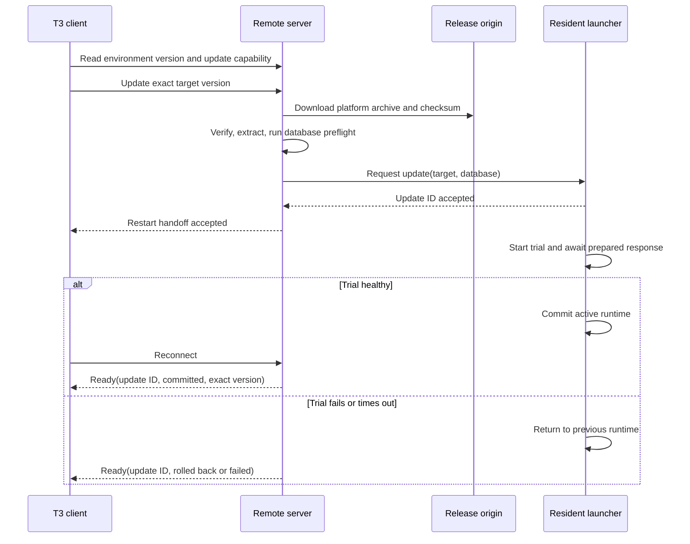

# Source-driven Canonfig updates (#304)

## Scope and evidence

Research against Canonfig `7070b8487191ec813e6405ab53d5591e9459a1df` and a fresh temporary checkout of upstream T3 Code at `9a455f02e2ddf35cc78c21757a96d3ffc3491622`. Existing T3 checkouts and live Canonfig installations were not changed. Sources and their limits are in [sources.md](sources.md). The implementation and isolated proof are separate deliverables; this document does not claim they have passed.

## What T3 actually does

1. The web client compares its bundled version with `serverConfig.environment.serverVersion`. It flags a server behind the client, rather than every difference. Nightly comparisons include the prerelease build. See `apps/web/src/versionSkew.ts:47-89`.
2. An update request supplies an exact target version. The server distinguishes desktop-managed updates from launcher-managed boot services. Unsupported launch modes receive a manual update path. It checks managed policy, cross-track database compatibility and an in-flight guard before staging. See `apps/server/src/cloud/selfUpdate.ts:53-58,121-138,177-218`.
3. The remote server downloads its own platform archive and release checksums, verifies SHA-256, extracts into staging and validates the runtime. It publishes a completed version directory with a sentinel. This path is not an arbitrary `npm install latest` and does not transfer the desktop's installed directory. See `apps/server/src/cloud/pinnedRuntime.ts:197-283,299-407`.
4. The candidate runs `__service-preflight --database-path ... --launcher-protocol ...`. The response must identify the requested version and report ready before the launcher accepts an update. See `apps/server/src/cloud/selfUpdate.ts:222-301,326-346`.
5. The resident launcher owns the active/trial process and update record. It starts a trial, waits for preparation, commits the selected runtime, or returns to the previous runtime on trial failure or timeout. See `apps/server/src/serviceLauncher.ts:1020-1248,1294-1335,1389-1441`.
6. The client reconnects and requires the matching update ID, committed outcome and exact server version. An accepted request or open socket is not success. See `packages/client-runtime/src/state/server.ts:144-192`.

The inspected archive path authenticates its checksum through the release download origin. It is not evidence that T3 verifies npm publisher provenance. Canonfig's requested publisher check needs an additional trust boundary.



## Prior art

| System | Version authority and activation | Useful here | Constraint |
| --- | --- | --- | --- |
| T3 Code | Client requests exact release; remote stages; resident launcher trials and commits it | Exact target, separate acceptance and completion, preflight, retained prior runtime | A follower launcher would introduce a resident daemon |
| VS Code Remote | Client installs and updates its server on connection; server lifecycle belongs to the client | Pair the remote runtime with the controlling client | Remote extensions are closed source; public FAQ proves automatic management, not an independently reviewed exact-commit installation algorithm |
| Tailscale | Per-device update opt-in; eligible online devices can receive admin-console Start update; release auto-updates are delayed for stability | Local authorization, inventory, staged availability | Depends on an online resident client; latest eligible release is not an exact Source release directive |
| Syncthing | Background synchronization process and monitor; upgrade command and automatic-upgrade opt-out | Keep update and restart outcomes distinct | Its process model differs from scheduled Canonfig followers; peer synchronization is not source-owned fleet release authority |
| Ansible pull | Scheduled local pull and execution; optional commit-signature verification; external locking required | Pull on the native schedule, authenticate instructions, exclude concurrent work | A general playbook executor is a much broader remote execution contract |
| Salt masterless | `salt-call --local state.apply` needs no minion daemon; local state tree | Bounded local execution can replace a resident worker | State distribution and release trust still need a separate contract |

## Chosen Canonfig design

- A **Fleet Update** selects the Source Machine's exact stable Canonfig version, not `latest`, a caller-supplied URL, a package name or a shell command.
- The Source explicitly starts it from the CLI or Version page, selecting a canary. All currently active enrolled followers participate, canary first, then one at a time. Enrollment after start is not silently added to that immutable target set.
- Followers explicitly opt in to Source-directed updates in local updater settings. Ordinary manual/automatic self-update policy remains separate. No new resident follower process, inbound listener or native schedule is installed.
- `sync --apply`, including its existing native scheduled invocation, checks for an update before opening a Synchronization Run. The update control endpoint is authenticated and TLS-pinned, but deliberately independent of the profile transport's major.minor gate. Otherwise a minor update could never repair the mismatch it caused.
- The Source signs a bounded directive using the existing Ed25519 signing identity. It binds protocol, rollout ID, sequence, follower identity, exact version, digest, state format and expiry. Followers pin that key to enrollment, reject stale/foreign/expired directives and do not accept an update from an untrusted signing key.
- Each follower obtains release evidence directly from the official npm registry. Require exact package/version, registry signature, SHA-512 tarball integrity and Sigstore provenance from `https://github.com/Microck/canonfig/.github/workflows/release.yml@refs/heads/main` with GitHub Actions' OIDC issuer. The registry's `maintainers` or `_npmUser` fields alone are not publisher proof. The current public 7.1.9 release has that provenance identity.
- Reuse the opted-in updater's gate, command leases, staged nested npm install, disabled lifecycle scripts, candidate smoke checks, journal and retained backup. Do not invent another activation path. The installed old process must not resume ordinary work after its code is replaced.
- Busy commands defer. An open or interrupted Synchronization Run prevents activation. A mismatched state format is a refusal, not an implicit migration. The candidate must be checked before activation and execute a real Synchronization Run afterward.
- Completion requires the new executable's exact version and a fresh Converged deployment receipt for this follower. The Source advances only on the matching authenticated report. Failed health halts the entire rollout. Missing health remains pending and never authorizes the next follower.
- Status distinguishes queued, deferred, updating, healthy and failed followers; Source stop prevents new admissions. An admission already activating cannot be remotely undone.
- Rollback is explicit: stop the rollout, recover any unfinished run with its creating build, stop the affected installation's processes, inspect and restore its retained package using the existing updater recovery procedure, verify version and status, then start a reviewed rollout. Automatic package reversal after Projection is unsafe because code rollback is not configuration rollback.

```mermaid
sequenceDiagram
    participant O as Operator
    participant S as Source Machine
    participant F as Canary Follower
    participant N as Official npm and Sigstore
    participant G as Next Follower
    O->>S: Start Fleet Update to Source version
    S->>S: Persist immutable signed target set
    F->>S: Scheduled sync checks authenticated update endpoint
    S-->>F: Signed exact-release admission
    F->>F: Verify enrollment signature, freshness and local opt-in
    alt Active command or Synchronization Run
        F-->>S: Deferred, installation unchanged
    else Idle
        F->>N: Independently verify release and publisher
        F->>F: Stage, preflight, journal and activate
        F->>F: New executable runs sync and records Convergence
        F-->>S: Matching version and health report
        alt Health passed
            S->>S: Admit next follower
            G->>S: Next native schedule checks admission
        else Health failed
            S->>S: Halt; keep remaining followers queued
        end
    end
```

## Threat model

| Threat | Boundary and mitigation | Remaining risk |
| --- | --- | --- |
| Spoofed Source | Enrollment-pinned TLS and Ed25519 signing identity; authenticated per-follower control endpoints | Source keys and follower credentials remain local secrets |
| Compromised Source requests malicious code | No remote executable, URL, registry or package-name input; follower independently checks official package provenance and digest | Compromise of the trusted release workflow, npm or Sigstore trust roots is outside Source-key protection |
| Tampered directive or tarball | Canonical signed payload, exact version and SHA-512 binding; registry signature and provenance subject must agree | A correctly signed official release can contain a defect |
| Replayed directive/report | Monotonic rollout sequence, bounded expiry, follower binding and current rollout/attempt identity | A compromised follower can lie about its own health; reports are not hardware attestation |
| Repudiation | Persist signed directive, phase transitions, local update journal and authenticated health outcome | Local administrators can alter local storage |
| Credential disclosure | Reuse credential references and pinned transport; do not publish tokens or npm authentication config | Reports must not contain raw subprocess logs or credential values |
| Denial of service | Bounded metadata/downloads/timeouts, one admission at a time; offline/busy/failing followers never count as healthy | A canary that remains offline stalls the rollout; operator must stop and start a reviewed rollout |
| Elevation of privilege | User-private npm prefix only; no sudo, scripts or arbitrary commands from Source | Canonfig and its declared dependencies run with the enrolled user's authority |
| Concurrent activation and sync | Existing command leases plus run exclusion; check unfinished state again before activation | External package managers do not participate; maintenance must exclude them |
| Unsafe rollback | Retained prior package, explicit recovery, no automatic state conversion | A failed health run may already have changed managed files; restoring code does not reverse those changes |

## Rejected alternatives

- SSH from Source to every follower: new credentials, bidirectional reachability and broader remote command authority.
- Resident follower updater: would allow immediate push, but violates the specified no-daemon model. Schedule latency is accepted instead.
- Merely installing the newest npm release: does not pin the Source's version or establish publisher trust.
- Signing an arbitrary URL with the Source key: Source compromise would authorize arbitrary code everywhere.
- Health equals process exit or `--version`: says nothing about continued Convergence.
- Updating inside an active run: risks replacing executable modules midway through recorded work.
- Automatic package rollback after failed Convergence: cannot safely reverse applied configuration or an unfinished run.
- Accepting missing provenance for local fixtures in production: would turn the proof seam into a security bypass. Isolated proof must supply its own verifier at the module boundary, never a production flag or environment override.

## Open risks and proof requirements

The first release containing this protocol must be installed on each follower before it can consume directives. Unsupported install methods and state-format changes remain explicit operator work. No immediate push or atomic filesystem rollback is claimed. Package dependencies remain a separate supply-chain trust surface.

Required proof: separate disposable Source/Follower HOMEs and N/N+1 packages; show `--version`, `status` and Source rollout status. Also exercise unsigned/tampered directives, active-run deferral and failed-health rollout halt. A local artifact proof cannot establish public Sigstore publisher verification; run that verifier separately against a real published release. Keep raw commands/output here and remove this entire research directory before merging.
